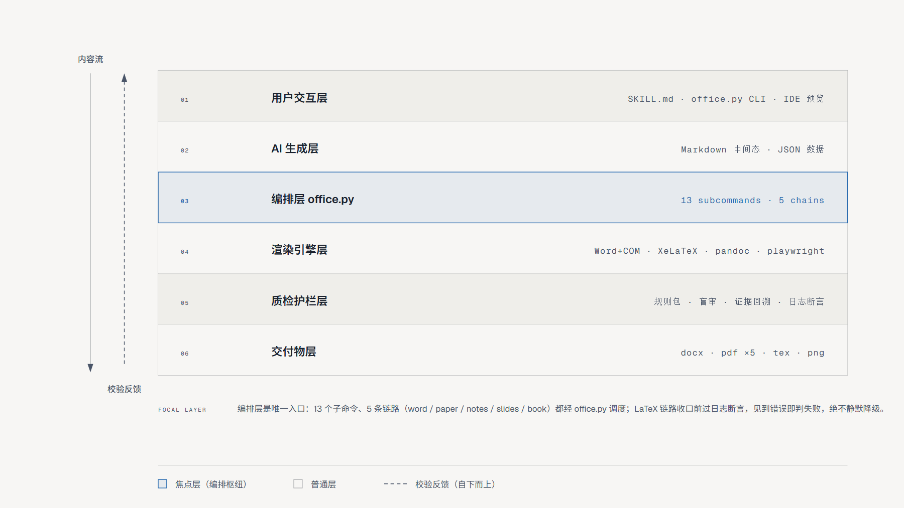

# 校园智能问答系统三期建设方案

> 副标题：从知识库到多智能体服务
> 作者：张三 计算机学院 2025000101
> 单位：示例大学
> 日期：2026年9月20日

**摘要：** 本文档为 skill 全链路演示样例，覆盖元信息、公式、表格、引用块、注释规范等排版能力。校园智能问答系统一期完成基础检索，二期引入向量召回，三期拟建设多智能体协作服务。检索质量可用召回率衡量，目标 $R \ge 0.9$。

**关键词：** 智能问答；知识库；多智能体；建设方案

# 一、现状回顾

一期与二期核心指标对比如表1所示，二期在长尾问题上提升明显。

> **表1：一期与二期核心指标对比**

| 指标 | 一期（关键词检索） | 二期（向量召回） | 三期目标 |
|------|------|------|------|
| 召回率 R | 0.72 | 0.86 | ≥0.90 |
| 平均响应 | 1.2s | 0.8s | ≤0.5s |
| 覆盖场景 | 教务通知 | +办事流程 | +个性化建议 |

# 二、三期总体设计

检索打分采用归一化加权形式：

$$ s(q,d) = \alpha \cdot \cos(\mathbf{v}_q, \mathbf{v}_d) + (1-\alpha) \cdot \text{BM25}(q,d), \qquad \alpha = 0.7 $$

其中 $\mathbf{v}_q, \mathbf{v}_d$ 为查询与文档的嵌入向量。多智能体层由路由智能体分派任务至检索、问答、推荐三个专职工具链。

> 注：路由置信度低于 0.6 的问题自动降级为人工工单。

# 三、实施排期

1. 第 1-2 周：嵌入模型升级与离线索引重建；
2. 第 3-4 周：路由智能体联调，灰度 10% 流量；
3. 第 5-6 周：个性化推荐上线，全量切换并复盘。

# 四、风险与对策

向量索引内存占用随语料线性增长，预计三期语料达 120 万段，需将检索节点内存从 16GB 扩至 32GB；另需防范灰度期间新旧排序结果不一致引发的用户困惑，对策是在答案底部标注来源版本。

**参考文献**

[1] 校园信息化办公室. 智慧校园建设指南. 2025.
[2] 张三, 李四. 多智能体知识服务系统设计与实现. 示例大学学报, 2026, 12(3): 45-52.

# 附录：本文档的生成链路

本文档由 harryopo-office skill 从同一份 Markdown 源渲染出 Word、PDF、讲义、幻灯片四种交付物。生产线共六层，内容自上而下流动，质检护栏自下而上校验，编排层 office.py 为唯一入口，整体架构如图1所示。

